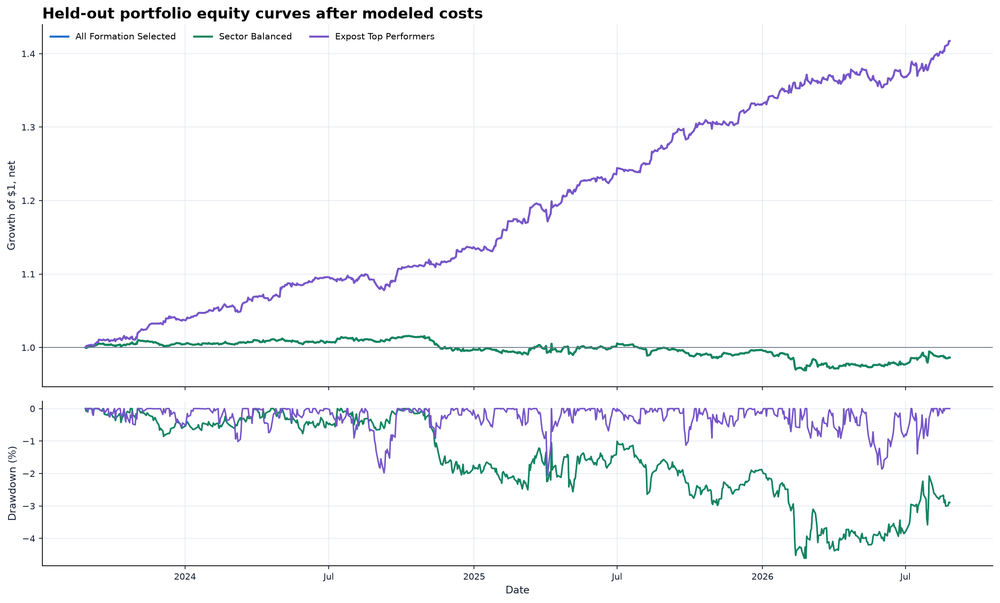
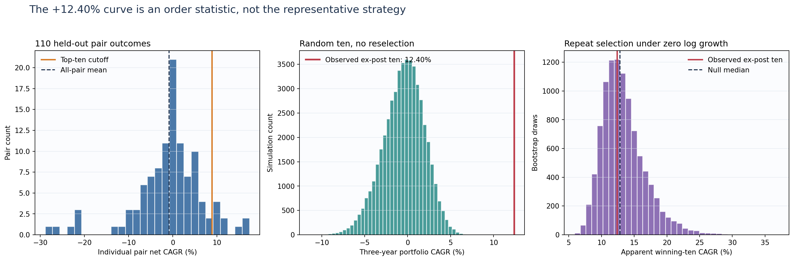
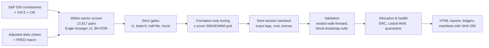
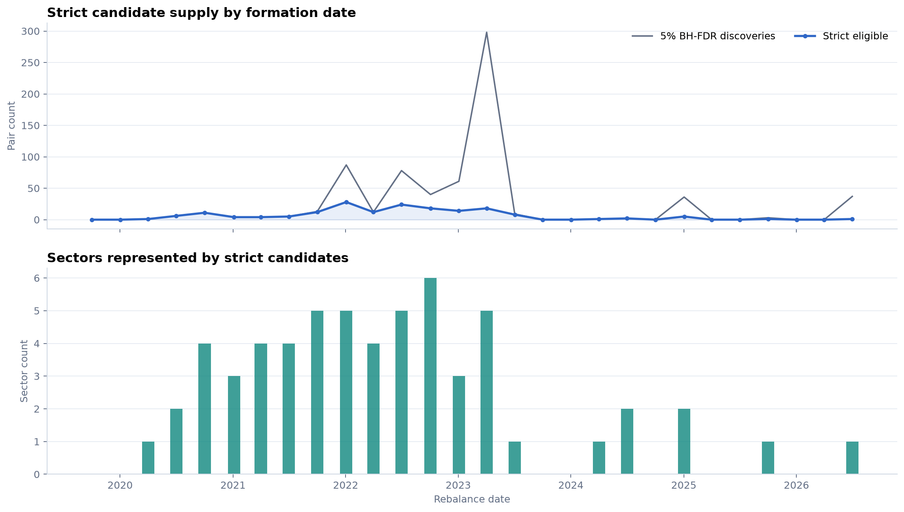

# US Equity Pairs: Does Classic Statistical Arbitrage Survive Costs?

Do within-sector cointegrated stock pairs in the S&P 500 still deliver a tradable edge once you account for chronology, multiple testing and realistic trading frictions?

  

## Research question

Pairs trading (buy the cheap leg, short the rich leg, wait for the spread to close) is one of the oldest quantitative strategies. With 500 large-cap stocks, every sector offers thousands of candidate pairs, so some will look cointegrated by chance alone. This project asks whether those relationships carry real, out-of-sample, after-cost profit, and if not, where any residual edge actually lives. It treats data-snooping and implementation details (next-session execution, borrow, liquidation) as first-class parts of the hypothesis.

## Key findings

- **The broad universe has no edge after costs.** All 13,917 different-issuer within-sector pairs were screened; the equal-capital portfolio of 110 formation-selected pairs, traded over a 3-year held-out window, earned **−0.46% net CAGR** (−4.62% max drawdown) at 5 bp one-way cost plus a 30 bp/yr short-borrow charge.
- **Strict statistics are scarce.** After two-orientation Engle-Granger testing, within-sector Benjamini-Hochberg FDR control, and I(1)/hedge-ratio/half-life/Hurst gates, **only 7 of 110** sector slots passed every gate; the other 103 were quota fills.
- **Winner selection manufactures performance.** The ex-post best ten pairs show **+12.40% CAGR**, but a circular-block null that repeats the winner-selection step under zero growth produces a median of the same size. The curve is an order statistic, not alpha.
- **Production controls don't recover it.** A purged nested walk-forward earned −3.57% CAGR; rolling pair-health monitoring left 0 of 10 pairs eligible at the sample end; a corrected strict-only replay earned +0.30% with a wide interval.
- **Where the residual edge sits: episodic, cross-sectional ranking.** In a 10-year rolling study (28 quarterly rebalances, 3-year formation windows, 2 bp cost), strict candidates appeared in clusters (up to 28 in one quarter, none in 9 quarters). The 118 selected pair-vintages had a **1.09% median next-quarter net return** (61.0% positive), and the training score ranked future returns (mean quarterly Spearman IC **0.250**, 95% block interval [0.150, 0.354]). But equal-quarter top-ten returns averaged −0.08% once empty quarters count as cash. The edge is local and intermittent, and it does not add up to a continuously investable portfolio.

<p align="center"></p>
<p align="center"><em>Formation-selected portfolio (green) vs. the ex-post top-ten curve (purple) over the 3-year held-out window, after modeled costs.</em></p>

<p align="center"></p>
<p align="center"><em>Left: 110 individual held-out outcomes. Middle: random ten-pair portfolios. Right: repeating the "pick the best ten" step under a zero-growth null reproduces the +12.40% curve.</em></p>

## Approach

The pipeline downloads current S&P 500 constituents with GICS sectors, adjusted daily closes and FRED macro series. It drops same-issuer share classes (by CIK), then runs an exhaustive within-sector cointegration screen with multiple-testing control. Selection uses only the formation window. Signals observed at close *t* trade at close *t+1*. Both stock legs are rebuilt in dollars so turnover, borrow carry and terminal liquidation are charged exactly. Later layers add constrained risk-based allocation (Ledoit-Wolf, equal-risk contribution), causal pair-health quarantine, purged nested walk-forward validation, block-bootstrap/data-snooping audits, and a rolling 10-year pair-vintage study with pair-specific tuning chosen by a one-standard-error rule.



## Repository layout

| Path | Contents |
| --- | --- |
| `src/equity_pairs/data.py` | Constituent, Yahoo price and FRED acquisition with checksummed exact-request caches |
| `src/equity_pairs/statistics.py` | Engle-Granger (both orientations), BH-FDR, half-life, Hurst, strict/fallback labelling |
| `src/equity_pairs/backtest.py`, `execution.py` | No-look-ahead pairs backtester; spread, impact, borrow, financing and liquidation cost model |
| `src/equity_pairs/pair_tuning.py`, `grid_search.py` | Leakage-controlled pair-specific signal tuning |
| `src/equity_pairs/validation.py`, `selection_inference.py` | Purged nested walk-forward, first-knowable gating, selection inference |
| `src/equity_pairs/allocation.py`, `weighted_portfolio.py`, `portfolio_risk.py` | Constrained ERC / min-covariance allocation across pair sleeves |
| `src/equity_pairs/pair_health.py` | Causal rolling relationship diagnostics and kill switch |
| `src/equity_pairs/pit_data.py`, `tradable_lineage.py` | Point-in-time universe contract and listing-lineage controls |
| `src/equity_pairs/pipeline.py`, `cli.py`, `reporting.py` | End-to-end orchestration, charts and self-contained HTML report |
| `scripts/` | Follow-up studies (weighted allocation, production gates, fallback credibility, 10-year rolling V6, identity replay, V7–V10 allocator experiments) |
| `configs/` | Frozen JSON protocols for each study |
| `docs/` | Methodology survey, V6 protocol, point-in-time data contract |
| `tests/` | 331 unit tests on synthetic data |
| `paper/` | Research paper (PDF) |

## Reproducing

```bash
python -m venv .venv && source .venv/bin/activate
pip install -e ".[dev]"
python -m pytest            # 330 pass, 1 skip; synthetic data only, no network

export FRED_API_KEY=...     # free key from fred.stlouisfed.org (see .env.example)
equity-pairs --as-of 2026-08-26 --config configs/default.json          # original 8-year study
python scripts/run_pair_optimized_10y_research.py --stage all           # 10-year rolling V6 study
python scripts/render_pair_optimized_10y_report.py
```

Prices come from Yahoo Finance via `yfinance` and constituents from the public S&P 500 list. Nothing is redistributed: every run builds its own snapshot under `outputs/` (git-ignored) and records SHA-256 hashes in a manifest. The V6 study reuses the constituent snapshot frozen by the first command. Follow-up scripts in `scripts/` read the saved artifacts and default to the 2026-08-26 output folders. Fresh downloads will differ slightly from the published snapshot.

## Paper / report

[`paper/equity_pairs_research_paper_2026-09-01.pdf`](paper/equity_pairs_research_paper_2026-09-01.pdf): *A Point-in-Time-Aware Equity Pairs Research Engine: Statistical Screening, Pair-Specific Tuning, and Ten-Year Evidence* (10 pp.).

<p align="center"></p>
<p align="center"><em>Strict candidate supply is regime-dependent: dense in 2021–2023, near zero afterwards.</em></p>

## Author

Siyan Chen · University of California, Santa Barbara · siyan_chen@ucsb.edu
